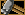
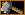
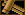
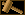

# Níveis (patentes)

Valor gravado em `Game.TotalGrade` / `SeasonGrade` / `CountryGrade` e mandado nos blocos de jogador (0x1012, 0x2001,
0x2111...). Menor = melhor. Quem recalcula é `gunbound/repository/ranking.py` (job diário), com a regra do RankCalc do
`BatchGIS.exe` de **2004** (0x4011f0; veio no pacote "Season 2 server"). O RankCalc muda por versão (versões novas trazem patentes
novas).

- **TH e S1: confirmado.** O `rank.img`/`rank1.img`/`rank2.img` do TH v404 e do S1 v495 são idênticos: 26 ícones (troféu,
  -4..19, martelo vermelho de admin). Fontes da internet (guia oficial Boleh copiado em 2009, emulador de TH do jglim, script
  "season 1" da Ragezone, gunboundclassic) trazem os mesmos GP (1100...6000, corte 6900), os mesmos percentuais acumulados
  (0,1/1/3/6/10/20/30/50/70%) e os dragões 1/4/16. Nenhuma fonte traz o +21 do L[i]; ele vem só do binário.
- **v584: outra escada.** O `rank1.img`/`rank2.img` do v584 tem 47 ícones, e o cliente desenha o u16 recebido direto
  como quadro (0x435f60/0x436140; copia o valor do pacote sem converter). Maior = melhor; ≥ 30 liga o `rankeff30..39`.
  É a escada da Softnyx/Level Up Brasil de 2010 (blogs e fóruns BR de 2010-2012, gunboundlatino), por GP fixo.
  Cada servidor roda uma versão só, então o banco guarda a patente na numeração dela: o job do servidor WCS2 grava
  1..41 (`Phase.rank_rule = 'v584'`, admin 0) e o servidor manda o valor do banco sem converter. País = total.
  Os times da QuickStart e a ordem de turno usam `Phase.higher_grade_better` (no S2 maior = melhor).
  `grade_min`/`grade_max` do config.yml ficam na numeração da versão. Banco vindo do S1: `python init_db.py WCS2`
  (admin 20 -> 0, os outros pelo GP e pela posição; o `DbVersion` impede rodar a conversão duas vezes). Conta nova ganha TotalGrade 19 do schema, que
  no S2 é estrela de prata até o job rodar (ele roda ao subir o servidor e às 4h).

| Quadro | Patente | GP mínimo |
|---|---|---|
| 0 | Administrador | TotalGrade 20 |
| 1 | Pintinho | resto |
| 2 / 3 | Martelo de Madeira / Duplo | 1100 / 1200 |
| 4 / 5 | Martelo de Pedra / Duplo | 1400 / 1600 |
| 6 / 7 | Machado de Metal / Duplo | 1900 / 2200 |
| 8 / 9 | Machado de Prata / Duplo | 2600 / 3000 |
| 10 / 11 | Machado de Ouro / Duplo | 3500 / 4000 |
| 12 / 13 | Metal Double Sided Axe / + | 4700 / 5400 |
| 14 / 15 | Silver Double Sided Axe / + | 6200 / 7000 |
| 16 / 17 | Gold Double Sided Axe / + | 7900 / 8800 |
| 18..22 | Estrela Bronze / Prata / Ouro / Dupla / Tripla | 10000 / 11000 / 12000 / 13000 / 15000 |
| 23..26 | Cetro Violeta / Safira / Rubi / Diamante | 17000 / 19000 / 24000 / 29000 |
| 27..29 | Dragão Azul / Vermelho / Prata | 34000 / 44000 / 54000 |
| 30..32 | Cavaleiro Azul / Vermelho / Prata | 64000 / 84000 / 104000 |
| 33..35 | Fênix Azul / Vermelha / Prata | 150000 / 200000 / 250000 |
| 36..38 | Medalha Bronze / Prata / Ouro | 400000 / 500000 / 600000 **e** posição ≤ 100 / 50 / 10 |
| 39..41 | Coroa Bronze / Prata / Ouro | 800000 / 1000000 / 2000000 **e** posição ≤ 3 / 2 / 1 |
| 42..46 | VIP, Troféu Bronze/Prata/Ouro, WC | o servidor nunca manda |

  - Medalhas e coroas: GP e posição (TotalRank/SeasonRank do job), como as tabelas BR trazem os dois números. Sem a
    posição, fica na fênix de prata. **[INCERTO]** se a posição era a geral ou a do país (o anúncio GIS fala em
    "Country Ranker 1~100"); aqui país = total, então dá no mesmo.
  - O v548 também é S2: a fase WCS2 toda usa esta escada (o XFS dele usa outra senha e não foi aberto).

| Grade | Nome | Imagem | Regra do emulador |
|---|---|---|---|
| -4 | Silver Dragon |  | posição 1 (≥ 6900 GP) |
| -3 | Red Dragon |  | posições 2–5 |
| -2 | Blue Dragon |  | posições 6–21 |
| -1 | Diamond Wand |  | posição 22..L[0] |
| 0 | Ruby Wand |  | posição > L[0] |
| 1 | Sapphire Wand |  | > L[1] |
| 2 | Amethyst Wand |  | > L[2] |
| 3 | Gold Double Sided Axe+ |  | > L[3] |
| 4 | Gold Double Sided Axe |  | > L[4] |
| 5 | Silver Double Sided Axe+ |  | > L[5] |
| 6 | Silver Double Sided Axe |  | > L[6] |
| 7 | Metal Double Sided Axe+ |  | > L[7] |
| 8 | Metal Double Sided Axe |  | > L[8] |
| 9 | Double Gold Axe |  | ≥ 6000 GP |
| 10 | Gold Axe | (sem imagem) | ≥ 5100 GP |
| 11 | Double Silver Axe |  | ≥ 4200 GP |
| 12 | Silver Axe |  | ≥ 3500 GP |
| 13 | Double Metal Axe |  | ≥ 2800 GP |
| 14 | Metal Axe |  | ≥ 2300 GP |
| 15 | Double Stone Hammer |  | ≥ 1800 GP |
| 16 | Stone Hammer |  | ≥ 1500 GP |
| 17 | Double Wood Hammer |  | ≥ 1200 GP |
| 18 | Wood Hammer |  | ≥ 1100 GP |
| 19 | Chick |  | abaixo de 1100 GP (conta nova começa com 1000) |
| 20 | GM | | fixo; o recálculo não mexe em quem tem 20 |

- ≥ 6900 GP, a patente vai pela posição geral: `L[i] = int(C × p[i]) + 21`, com C = quantos têm ≥ 6900 e
  p = 0.001, 0.01, 0.03, 0.06, 0.10, 0.20, 0.30, 0.50, 0.70. Empate repete a posição e a patente do primeiro do empate
  (1, 2, 2, 4). Com menos de 1000 jogadores ≥ 6900, L[0] = 21 e o -1 não aparece. Quem tem `NoRankUpdate` fica de fora.
- A tabela `GradeLimit` (238204, 227295...) não entra no cálculo; é só exibição (0x7001).
- Servidor de um país só: `CountryGrade`/`CountryRank` copiam `TotalGrade`/`TotalRank`.
- `grade_min` / `grade_max` do `config.yml` usam esta escala (19 = Chick, -4 = Silver Dragon).
