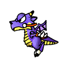
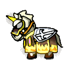

# Tanques (mobiles) e itens

## Tanques

Escolha na sala: 0x3200 = u8 primário + u8 secundário (o secundário só vale no Tag; `0xFF` = aleatório). O servidor
grava os dois em `Game.ClientData[0:2]` e usa como escolha inicial na próxima sala (`room_select_tank.py`).
Índices aceitos: 0..15 e `0xFF` (`TANK_COUNT = 16` em `gunbound/base/enums.py`).

| Imagem | Tanque | Índice |
|:---:|---|---|
|  | Armor | 0x00 |
|  | Mage | 0x01 |
|  | Nak | 0x02 |
|  | Trico | 0x03 |
|  | BigFoot | 0x04 |
|  | Boomer | 0x05 |
|  | Raon Launcher | 0x06 |
|  | Lightning | 0x07 |
|  | J.D | 0x08 |
|  | A.Sate | 0x09 |
|  | Ice | 0x0A |
|  | Turtle | 0x0B |
|  | Grub | 0x0C |
|  | Aduka | 0x0D |
|  | Kalsiddon | 0x0E |
|  | J.Frog | 0x0F |
|  | Dragon | [INCERTO] |
|  | Knight | [INCERTO] |
| | aleatório | 0xFF |

- Dragon e Knight: emuladores do TH usam 17/18 (14/15 em outra versão); não conferido nos clientes WC. Hoje o
  servidor recusa índice ≥ 16.
- Os mobiles do S2 (Tiburon, Frank, Maya, Phoenix, Wolf, Blue Whale) também não têm índice conferido. **[INCERTO]**
- Versões antigas deste arquivo mostravam o código como `NN 03` (o enum `Tank` ainda tem esses valores). Eram os 2
  primeiros bytes do `ClientData` lidos juntos: primário `NN` e [provável] secundário 3 na captura. O servidor trata
  como dois u8.

## Itens de batalha

Códigos dos itens equipados, como aparecem no `ClientData` depois dos tanques (captura do v440). Item de 2 espaços
ocupa 2 bytes (`FF` + código).

| Imagem | Item | Código |
|:---:|---|---|
|  | Dual | `FF 01` |
|  | Dual+ | `FF 02` |
|  | Blood | `03` |
|  | Energy 1 | `07` |
|  | Energy 2 | `FF 07` |
|  | Change Wind | `0F` |
|  | Team Teleport | `FF 0B` |
|  | Bunge Shot | `01` |
|  | Power Up | `02` |
|  | Thunderbolt | `FF 06` |
|  | Teleport | `FF 0A` |

## `Game.ClientData` (captura do v440)

| Bytes | Conteúdo |
|---:|---|
| 2 | tanque primário e secundário |
| 6 × 1 | itens (um item de 2 espaços ocupa 2 bytes) |
| 1 | `0x24` [INCERTO] |
| 91 | `0x00` [INCERTO] |
