| Imagem                                        | Tank Equipado | Código |
|:---------------------------------------------:|---------------|--------|
| 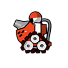               | Armor         | 00 03  |
| 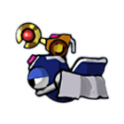                 | Mage          | 01 03  |
| 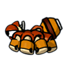                   | Nak           | 02 03  |
|                | Trico         | 03 03  |
| 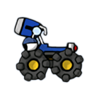           | BigFoot       | 04 03  |
| 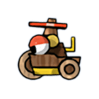             | Boomer        | 05 03  |
| 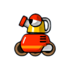 | Raonlauncher  | 06 03  |
| 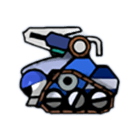     | Lightening    | 07 03  |
| 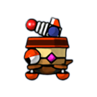                    | JD            | 08 03  |
|             | A.Sate        | 09 03  |
| 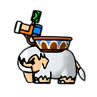                   | Ice           | 0A 03  |
| 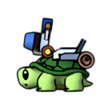             | Turtle        | 0B 03  |
| 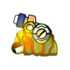                 | Grub          | 0C 03  |
| 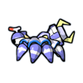               | Aduka         | 0D 03  |
| 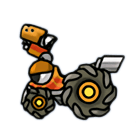       | Kalsiddon     | 0E 03  |
| 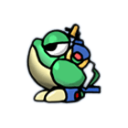             | J.Frog        | 0F 03  |
|              | Random        | FF 03  |

| Imagem                                          | Itens equipados | Código |
|:-----------------------------------------------:|:----------------|-------:|
|                   | Duplo           | FF 01  |
| 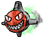                | Sangue          | 03     |
|           | Energia 2       | FF 07  |
|           | Energia 1       | 07     |
|                 | Duplo+          | FF 02  |
|   | Vento Changin   | 0F     |
| 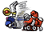 | Team Teleport   | FF 0B  |
| 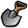       | Bunge Shot      | 01     |
| 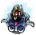              | Ligar           | 02     |
| 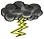     | Thunderbolt     | FF 06  |
| 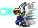           | Teleport        | FF 0A  |

| ClientData | Bytes | Descrição |
|------------|------:|-------------------------|
| Tank       | 2     | Código do Tank equipado |
| Itens      | 1     | Código do Item, podendo ocupar 2 bytes |
| Itens      | 1     | Código do Item, podendo ocupar 2 bytes |
| Itens      | 1     | Código do Item, podendo ocupar 2 bytes |
| Itens      | 1     | Código do Item, podendo ocupar 2 bytes |
| Itens      | 1     | Código do Item, podendo ocupar 2 bytes |
| Itens      | 1     | Código do Item, podendo ocupar 2 bytes |
| 0x24       | 1     | Desconhecido |
| 0x00       | 91    | Desconhecido |